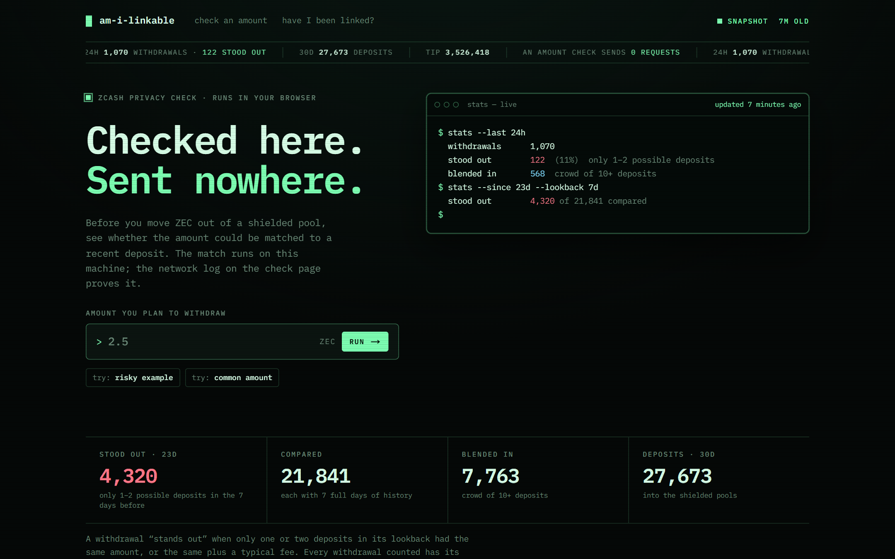
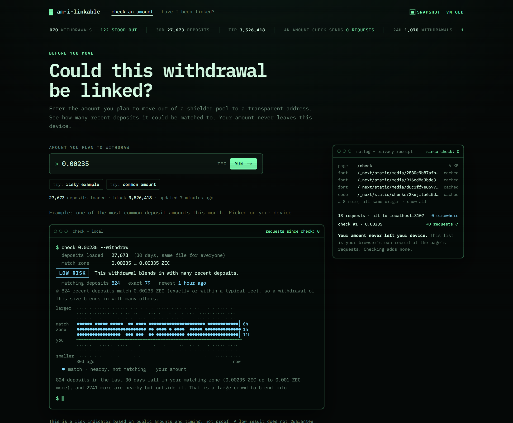

# Am I Linkable?

**See whether your Zcash shielding can be traced, without telling anyone what you checked.**

**Live: <https://am-i-linkable.vercel.app>** · Built for ZECATHON (Core & Tooling track) during the October 2026 build window.



## The problem

Inside a shielded pool, amounts and addresses are hidden. At the edge of the
pool they are not: when ZEC moves from a transparent address into a pool, or
back out to one, the amount and the time are public. If 12.4 ZEC goes in and
12.39985 ZEC comes out two hours later, anyone can pair the two, and the
privacy the pool was meant to give is gone. This is a **round trip**.

It is not a theoretical risk:

- Quesnelle, [*On the linkability of Zcash transactions*](https://arxiv.org/abs/1712.01210)
  (2017), estimated that **31.5%** of coins sent to shielded addresses were
  likely part of a round trip.
- Kappos, Yousaf, Maller and Meiklejohn,
  [*An Empirical Analysis of Anonymity in Zcash*](https://www.usenix.org/conference/usenixsecurity18/presentation/kappos)
  (USENIX Security 2018), linked most of the value withdrawn from the pool and
  cut the anonymity set by **69.1%**, using amount and timing heuristics.

Both were studies of the whole chain. Users had no way to check their own
exposure, and asking a website "is my address linkable?" would itself leak the
address. Am I Linkable? lets you check without telling anyone.

## Two tools

### Before you move: `/check`

Type the amount you plan to withdraw from a shielded pool. The page downloads
every deposit from the last 30 days (the same file for everyone) and counts, on
your device, how many recent deposits your amount could be matched to. You get
a risk level, a crowd plot and concrete suggestions. **A check sends nothing.**



### Have I been linked?: `/linked`

Paste a transparent address you have used (t1, t3 or TEX). Your browser
hashes it with SHA-256 and downloads only the bucket its first 5 bits fall in:
one of 32 buckets, each holding about 1,200 addresses or more (a k-anonymous
lookup, like HaveIBeenPwned). It finds your address in the bucket locally and
explains each deposit and withdrawal from the last 30 days in plain English,
colour-coded by risk. **Paranoid mode** downloads all 32 buckets (about 3.1 MB),
so not even the bucket number is revealed.


*This screenshot uses a demo address with illustrative events, so no real
person's address appears in it. Everything else on the page is live data.*

## Why it doesn't leak

- **Your amount never leaves your device.** Neither does your address, nor its
  hash: `/linked` sends only a bucket number.
- **Every data response is identical for everyone** who asks for it, and the
  site has no cookies, storage, accounts, analytics or third-party requests.
  A strict Content-Security-Policy keeps it that way.
- **Buckets hold hashes, never addresses**, and never say who was on the other
  side of a movement, only how many movements could match.
- **You can see it yourself:** each page shows a live network log built from
  your browser's own record of its requests.

The full model is in [docs/PRIVACY.md](docs/PRIVACY.md). Every layer was
audited before submission (browser, headers, hosting, data, collector, repo,
dependencies), with evidence for each item, in [docs/AUDIT.md](docs/AUDIT.md).
The browser part is a script you can re-run: `node apps/web/scripts/privacy-audit.mjs <url>`.

## Architecture

```
3xpl  ── public Zcash blocks (JSON API + daily dumps)
  │
  ▼
collector (Node, on Railway)
  keeps the last 30 days of shield/unshield events in memory, follows the tip,
  handles reorgs, and builds compressed snapshot rows: the deposits file,
  the stats and 32 address buckets (hashes only)
  │
  ▼
Neon Postgres ── `snapshots` table (the website's role can only SELECT this table)
  │
  ▼
Next.js on Vercel
  serves the snapshot rows as they are: same bytes for everyone, cached
  │
  ▼
your browser
  does all the matching (packages/core) and shows exactly what it sent
```

## What's real and what isn't

- **Real:** everything on the live site. It runs on Zcash mainnet data, which
  the collector follows continuously and republishes when it changes.
- **No wallets, keys or funds.** The tool never asks for keys, seed phrases or
  spending authority, and it cannot move anything.
- **Demo data only in two places:** the `/linked` screenshot above, and
  fixture mode for local development, which serves saved copies of the public
  snapshots.

## Known limitations

- **The host sees IP addresses and request times**, like any website. On
  `/linked` it also sees the bucket number: your address is one of about 1,200.
  Paranoid mode avoids even that. Use Tor or a VPN if you need more.
- **30-day window.** Older activity is not covered, and "nothing found" proves
  nothing about it. Movements of 0.001 ZEC or less (dust) are left out.
- **One data source.** Chain data comes from 3xpl; if it is wrong or down, so
  are we. 3xpl only ever sees our collector, never visitors.
- **A risk signal, not proof.** The heuristics use public amounts and timing
  only. Someone with exchange records or network data may know more; a "high
  risk" result means a pattern exists, not that anyone has linked you.
- **Scope.** Transparent-to-transparent payments and moves between shielded
  pools are not checked.
- **One open audit item.** On Vercel the CSP currently allows inline scripts
  (scripts still load only from this site); see [docs/AUDIT.md](docs/AUDIT.md).

## Run it locally

Requirements: Node.js 22.15 or newer and pnpm 9 (`corepack enable`).

```bash
git clone https://github.com/Adeolu05/am-i-linkable.git
cd am-i-linkable
pnpm install
node apps/web/scripts/save-fixtures.mjs   # saves the public snapshots (~4 MB, once) into data/fixtures
```

Then start the website in **fixture mode**: no database, no keys.

```bash
cd apps/web
SNAPSHOT_FIXTURES_DIR=../../data/fixtures pnpm dev
```

(In PowerShell: `$env:SNAPSHOT_FIXTURES_DIR = "../../data/fixtures"; pnpm dev`.)
Open <http://localhost:3000>.

Tests and type checks: `pnpm test` and `pnpm typecheck`. Running the collector,
deploying to Railway and Vercel, database egress and the read-only database role
are covered in [docs/RUNNING.md](docs/RUNNING.md).

## More

- [docs/SPEC.md](docs/SPEC.md): how the tools and the data work
- [docs/PRIVACY.md](docs/PRIVACY.md) and [docs/AUDIT.md](docs/AUDIT.md): privacy model and audit
- [docs/PRIOR_ART.md](docs/PRIOR_ART.md): the research above and related tools
- [docs/BUILD_LOG.md](docs/BUILD_LOG.md): how it was built, step by step

Public chain data from [3xpl](https://3xpl.com). Thank you to the 3xpl team.

## License

[MIT](LICENSE), copyright 2026 David Peluola.
